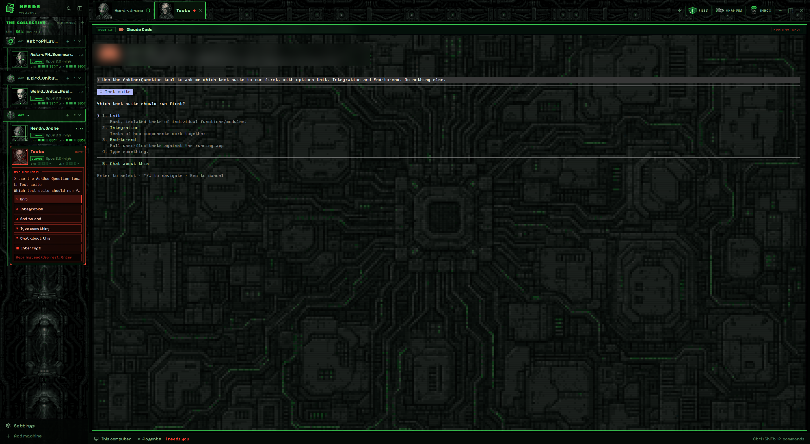

# Collective

A cybernetic hive-mind layout for the [Herdr](https://herdr.dev) desktop app, drawn in pixel art. Your coding agents become drones in a collective. Each drone has an animated 48×48 pixel-art face, a designation like "THREE OF FOUR", and two LED power cells: CORTEX (context left) and LINK (5-hour quota left). While an agent works, its drone sweeps an ocular laser across the screen. When an agent needs you, the face glitches red. Spaces are numbered sectors with pixel-art locations, a rotating pixel cube sits in the corner, and the whole window glows hive green over a dark circuit hull.



Collective follows the structure of [herdr-inferno](https://github.com/rbkuhn/herdr-inferno), which is built on [herdr-traveler](https://github.com/franky5440-afk/herdr-traveler). All of its art, animation, sound and styling is new.

## Install

```sh
git clone https://github.com/rbkuhn/herdr-collective
cd herdr-collective
H=~/.config/herdr-app
cp layouts/collective.json layouts/collective.png "$H/layouts/"
cp themes/collective.json "$H/themes/"
cp -r mods/collective-agents mods/collective-chrome mods/collective-pane mods/collective-spaces mods/collective-tabs "$H/mods/"
herdr-app do layout.switch '{"name":"collective"}'
```

Press `ctrl-shift-l` to switch back. To remove Collective, delete the files you copied.

### Optional: fill the Cortex and Link cells (Claude Code)

The cells read a small cache file that a Claude Code statusline writes:

```sh
mkdir -p ~/.config/herdr-app/scripts
cp scripts/collective-statusline.sh scripts/collective-record.mjs ~/.config/herdr-app/scripts/
```

Then set Claude Code's statusline in `~/.claude/settings.json`:

```json
"statusLine": { "type": "command", "command": "/bin/sh ~/.config/herdr-app/scripts/collective-statusline.sh" }
```

The script needs `node`. It records the numbers without printing anything, so your statusline stays empty. If you already have a statusline, add a line to `collective-statusline.sh` that pipes `$input` into it. If you already use Inferno's or Traveler's statusline, skip this step: they write the same cache. Without any of them, the cells show "—".

### Optional: sounds

A hive chorus of six voices runs through a metallic radio filter. "Task complete." plays over a cold chime. For "an agent needs you", a short, quiet klaxon plays first, then the chorus says "Your input is required." on its own, so the words come through clearly. To use them, add this to `~/.config/herdr-app/settings.json`. This setting applies to every layout:

```json
"sounds": {
  "enabled": true,
  "done": "mods/collective-chrome/sounds/done.mp3",
  "blocked": "mods/collective-chrome/sounds/blocked_voiced.mp3"
}
```

`blocked.mp3` is the older take, with the voices mixed under the klaxon. `done_fx_only.mp3` and `blocked_fx_only.mp3` are the effects without the voices. Clicking a drone card always plays `blip.mp3`.

## Customise

- **Which drone a tab gets:** edit `mods/collective-agents/jobs.json`. It maps tab names to roles: tactical, medical, engineer, scout, analyst, navigator, infiltrator or sentinel. Tabs not listed get a role based on their name.
- **Which location a space gets:** edit `mods/collective-spaces/places.json`, e.g. `{"my-space": "vortex"}`. The choices are cube, sphere, alcove, planet, nexus and vortex.

## Credits and licences

- Code: Apache-2.0 (see `LICENSE` and `NOTICE`). It is adapted from Herdr's shipped mods and from herdr-traveler, both Apache-2.0.
- Art: the drone faces, locations, icons and backgrounds were generated with OpenAI image models for this project. They were then reduced by script to a fixed 24-colour palette and animated frame by frame. They are released under Apache-2.0.
- Sounds: generated with ElevenLabs on a paid plan, then processed with ffmpeg. They are released under Apache-2.0.
- Fonts: [Silkscreen](https://fonts.google.com/specimen/Silkscreen), [Pixelify Sans](https://fonts.google.com/specimen/Pixelify+Sans) and [VT323](https://fonts.google.com/specimen/VT323), SIL Open Font License 1.1 (see `mods/collective-chrome/fonts/OFL-*.txt`).

Collective is an original work. It is not affiliated with or endorsed by any film, TV or game studio.
