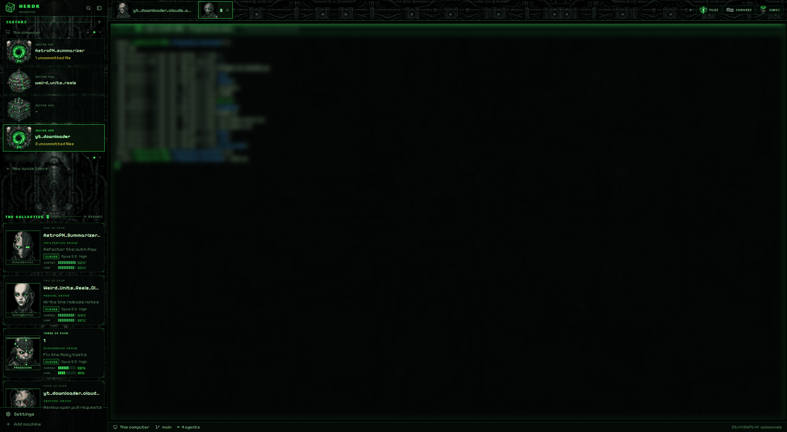

# Collective

A cybernetic hive-mind window for Herdr, in pixel art. The left sidebar is a dark wall of regeneration alcoves. It lists spaces as numbered "Sectors", each with a pixel-art location (cube ship, sphere ship, alcoves, half-assimilated planet, data spire, energy vortex). Below them, "The Collective" shows every agent as a drone card: an animated 48×48 pixel-art face, a designation ("THREE OF FOUR"), a role, and two 10-segment LED power cells, CORTEX and LINK. The tab bar is a pixel conduit strip with a drone face on each tab. Terminals sit over a dark circuit-board hull at 72% opacity, in panes with a hive-green HUD header.

## What you see

Left to right, top to bottom:

- **Sidebar**: 300px wide, fixed. Background: `mods/collective-chrome/art/sidebar.png` (cover), a dark pixel-art alcove wall.
  - **Brand**: 46px, `#020503d0` with a `#1f5c2c` bottom line. A 30px rotating pixel cube, then "HERDR" in Silkscreen 700 14px `#39d353` over "COLLECTIVE" in Silkscreen 7px dim. Search and sidebar-toggle buttons on the right. Draggable.
  - **Sectors** (spaces): a header with "SECTORS" in Silkscreen 700 10px `#39d353`, a 1px `#1f5c2c` rule and a + button. Rows are 76px with 72px location art (36×36 pixel art drawn ×2, nearest-neighbour). Over the name is "SECTOR 001" (3 digits, list order) in Silkscreen 7.5px, green when active, else dim. The name is 13px, 700 `#b8ffbf` when active. Git lines below it. The active row is `#071409e8` with a 1px `#39d353` border; others are `#030805c8` with `#0f2a16`, hovering to `#0b2010f0`. Spaces are grouped by machine, with worktrees nested under their repo.
  - **The Collective** (agents): a header with "THE COLLECTIVE" in Silkscreen, a blinking green block cursor, a rule and "N DRONES". Then one card per agent.
  - **Footer**: 69px, `#020503e0` with a `#1f5c2c` top line. Settings and Add machine.
- **Tab bar**: 58px over `mods/collective-chrome/art/strip.png`. Tabs are 48px, with a 44px drone face (when the tab maps to a role) and the name at 12.8px. The active tab is `#071409f0` with a 1px `#39d353` border and `#b8ffbf` text; others are `#030805d0` with `#0f2a16`. Then a + menu, and Files, Changes and Inbox buttons with pixel icons (`mods/collective-tabs/art/*.png`) and Silkscreen 8.5px labels. Window buttons sit on the right.
- **Terminal area**: 8px padding and gap. Every pane, even a lone one, has a 28px `collective-pane` header, a 1px `#1f5c2c` border (`#39d353` when focused), radius 0, and `mods/collective-chrome/art/map.png` behind the terminal at `terminal_opacity` 0.72.
- **Pane header**: `#020604` (`#04100a` focused). A framed "NODE T11" tag (the terminal id) in Silkscreen 7.5px `#2f9a48`, the program icon tinted `#39d353`, the name in 700, and the folder. On the right is the status. Split, zoom and close buttons appear on hover.
- **Status bar**: 28px, Herdr's `workspace-status` over `mods/collective-chrome/art/footer.png`.
- **Theme** `collective`: background `#030604`, foreground `#c4e8c0`, accent and working `#39d353`, blocked `#ff4433`, done `#5ce1e6`, idle `#3d5a45`, chrome `#040a06`, surface `#06100a`, raised `#0d1f13`, border `#1f5c2c99`. ANSI: `#030604 #e0443a #39d353 #c9c04a #4aa3d9 #9a6cd0 #3cc9b0 #c4e8c0 / #3d5a45 #ff6a5a #7dff8f #e6dc6a #7cc4ee #b894e6 #6ee6cf #ecfbe8`.
- **Fonts**: the UI font is Pixelify Sans. Silkscreen is used for HUD labels. VT323 is bundled too. All three are in `mods/collective-chrome/fonts/`.

### A drone card

The background is `#030805e8`, or `#071409f0` when focused, with a 1px `#0f2a16` border (state colour at 60% when the agent is focused or blocked). A 2px L-shaped HUD bracket sits on each corner.

- **Face**: 96×96, black, 1px border in the state colour. It shows the drone's animation for the current state. A 12px `#000000c8` strip across its bottom reads the state in Silkscreen 7px: PROCESSING, AWAITING INPUT (blinking), COMPLETE or REGENERATING.
- **Designation** in Silkscreen ("ONE OF FOUR": the card's place in the list, out of the total). Then the tab name, 700. Then "<ROLE> DRONE" in Silkscreen. Then the session name, if Claude Code's `/rename` set one. Then a framed CLAUDE tag with "model · effort".
- **Power cells**: CORTEX and LINK, each 12px tall: a 36px Silkscreen word, ten 4×8 lamps and the percentage. Lamps are `#39d353`, `#e8b13a` under 30% and `#ff4433` under 15%. Unlit lamps are `#0d1f12` with a `#163d20` border. If the value is more than 5 minutes old, the colour dims to `#2f9a48` and a `*` follows the number. Without data, the lamps are dark and the number is "—". Codex and OpenCode agents show no cells.

## How it behaves

- **Drone faces** per agent state. Each state is one horizontal strip of 48×48 frames, upscaled ×4 to 192px and shown at 96px. Frames: rest 32 at 110 ms, done 16 at 110 ms, working 24 at 75 ms, blocked 12 at 90 ms.
  - **Regenerating** (idle, or no status): the drone blinks once per loop. Its green implant LEDs breathe out of phase, its red ocular implant pulses, a faint scanline drifts down, and sparse green data rain falls behind it.
  - **Processing** (working): a red laser from the ocular implant sweeps back and forth. Drones without an eye implant get a green vertical scan beam instead. A bright scan bar runs down the face, the LEDs flicker fast, and the data rain gets heavy.
  - **Awaiting input** (blocked): the mouth opens, the LEDs turn red, and the face is tinted red with a pulse. Rows glitch sideways, the red channel splits, red noise pixels flicker, and a red warning lamp blinks in the corner.
  - **Complete** (done): a bright green beam crosses the face and leaves a 4px green assimilation grid that fades out. The LEDs turn cyan.
- **Roles**: `mods/collective-agents/jobs.json` maps tab names to roles, matched case-insensitively. Unmapped tabs get a role from a hash of their name, skipping roles already used until all 8 are taken.
- **Locations**: `mods/collective-spaces/places.json` maps space names to places. Other spaces get a place from a hash of their name.
- **Brand cube**: rotates continuously (36 frames at 90 ms).
- **Pane header status**: a native `.frames` pixel spinner (`▖▘▝▗`, 120 ms) with "PROCESSING" while working. "AWAITING INPUT" blinks red while blocked. "COMPLETE" shows in cyan when done.
- Click a card to play `mods/collective-chrome/sounds/blip.mp3` and run `agent.focus`. Click a sector to select it, right-click for its menu, drag to reorder. Tabs: click selects, double-click renames, drag reorders, right-click opens a menu, the mouse wheel cycles. Files, Changes and Inbox toggle the right panel, remembered per space.

## Built from

- **Layout tree**: root `row`: `sidebar` column [`brand` block `collective-chrome`, `sidebar-lists` column [`spaces` `collective-spaces`, `agents` `collective-agents`], `sidebar-footer` `collective-chrome` with props `{footer:true}`] and `work` column [`tabs` `collective-tabs`, `work-body` row [`main` `{tab:"active"}` with a pane frame whose header is `collective-pane`, `panel` column (hidden) holding a `panel-body` stack of `files`/`changes`/`inbox`], `status` `workspace-status`]. Root: `theme: "collective"`, `ui_font: "Pixelify Sans"`, `terminal_opacity: 0.72`, `terminal_padding: [14,12]`, `titlebar: "none"`, divider 1px `#0f2a16`, `preview: "layouts/collective.png"`.
- **collective-agents**: draws `agents()` and calls `setAgentOrder`. An 80 ms `cx.timer.every` clock calls `cx.notify()` while `window().active`, and every third tick otherwise. It skips this when there are no agents. Each render sets `left(-frame * 96)` on the strip image inside an `overflow_hidden` face box. The cells come from `data/traveler/sessions/<terminal>.json` (`{updatedAt, contextRemainingPct, fiveHourRemainingPct, sessionName, model, effort}`), read with `readTextFile` and `watchFolder`. Remote agents are read with `readTextFile(..., {on})` every 60 s. `lib.js` holds the role list, `designation()` and the animation table. `collective-tabs` has its own copy of `lib.js`.
- **collective-chrome**: brand and footer. The cube is a 36-frame strip (`art/cube.webp`) stepped by its own 90 ms timer. The mod also holds the fonts, sounds and backgrounds.
- **collective-pane**: a restyled clone of Herdr's `pane` mod. It reads `panes()` and runs `pane.split`, `pane.zoom` and `pane.close`.
- **collective-spaces**, **collective-tabs**: restyled clones of the inferno mods, which are clones of herdr-traveler's, which are clones of Herdr's `spaces` and `tabs`. They use `spaces()`, `panes()`, `exec("git", …)`, `hc(["machine","ls"])`, `openOverlay` for the `menu` and `new-menu` mods, and `layout.select`/`layout.show`/`layout.hide`.
- **scripts/collective-statusline.sh** with **collective-record.mjs**: a Claude Code statusLine. It reads `context_window.remaining_percentage` (or `100 - used_percentage`) and `rate_limits.five_hour.used_percentage` from stdin. It writes the cache file named by `$HC_TERMINAL_ID`, atomically, and prints nothing.
- **Art pipeline**:
  1. Generate each image with OpenAI image models. Faces, locations and icons were generated on transparent backgrounds; backgrounds were generated opaque. The blink and alert faces are image edits of the base face.
  2. Crop to content and BOX-downsample to the target grid: 48 for faces, 36 for locations.
  3. Quantize to one fixed 24-colour palette (blacks, gunmetal greys, pale skin, hive greens, implant reds, cyan) with no dithering. Alpha is binary, with a threshold of 110.
  4. Upscale with nearest-neighbour.
  5. Build the animation frames by script on the 48px grid. LED and implant masks are found by colour in the source image. The blink and alert patches are the pixels that changed in the busiest row band of the aligned edit. The beams, rain, grid and glitches are drawn per frame.
  6. Save the strips as lossless WebP.
- **Sounds**: ElevenLabs TTS lines, one per voice for six voices, layered as a chorus. They were run through ffmpeg flanger, echo, bitcrush and band-pass filters, then mixed 380 ms after an ElevenLabs sound-effect bed.

## Watch out

- **Herdr's `image()` draws only the first frame of a GIF or animated WebP.** Sprites must be strips stepped from the mod. A native `.loop()` only swings a value back and forth, so it can't step frames.
- Keep pixel art crisp. Downsample with BOX, then quantize to the fixed palette with dithering off, then upscale only with nearest-neighbour. Any smooth resize afterwards blurs the pixels.
- The LED and implant colour masks are touchy. Loose thresholds speckle the whole face; strict ones find nothing. Use saturation ratios (`g > r·1.45 and g > b·1.15`; `r > g·1.9 and r > b·1.8`) on a BOX-downsampled copy of the raw image, not the quantized one.
- Image edits shift the face by a pixel or two. Align each edit to the base (±3 px) before diffing, or the blink patch includes the whole outline.
- gpt-image-2 ignores transparent backgrounds and paints a fake checkerboard. Use gpt-image-1.5 with `background: "transparent"` for cut-outs.
- `mod.clone` rewrites `mods/<name>/` paths. A later find-and-replace of the old name silently misses them; check `PORTRAITS_DIR` in `lib.js`.
- The card cells share `data/traveler/sessions` with herdr-traveler and herdr-inferno on purpose, so any of their statuslines fills all three layouts.
- Sounds are a global Herdr setting: they play in every layout.
- The animation redraws the window about 12 times a second while Herdr is focused, and about 4 times a second otherwise.

## Done when

- `herdr-app check` passes for all five `mods/collective-*` folders, and `herdr-app status` shows `"layout": "collective"` with no errors.
- Screenshots a fraction of a second apart show a resting drone blinking or its LEDs changing. A working Claude Code agent's drone shows a laser or scan beam in a different place in each one.
- With the statusline installed, a Claude Code card shows CORTEX and LINK percentages that match its context and 5-hour usage. Without it, the cells show "—".
- The brand cube visibly rotates. Sector rows show location art and "SECTOR 00N", and the active one has a green frame. Tabs show drone faces. Files, Changes and Inbox toggle the right panel.
